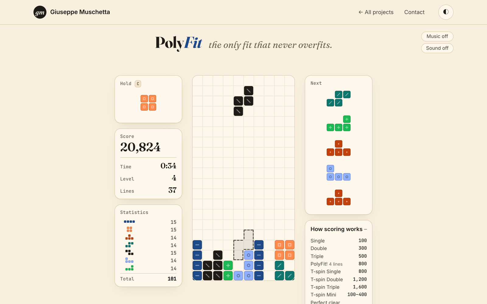

# PolyFit

*PolyFit — the only fit that never overfits.*

**Play it at [giuseppemuschetta.com/challenge](https://giuseppemuschetta.com/challenge/)**: three minutes, one score, and Giuseppe's record to beat.

[Read the technical report](REPORT.pdf) · [Features](#features) · [Run it](#run-it) · [Tests](#tests) · [Project structure](#project-structure)

<picture>
  <source media="(prefers-color-scheme: dark)" srcset="docs/polyfit-dark.png">
  
</picture>

A falling-blocks puzzle game with modern rules, written from scratch in plain JavaScript: no frameworks, no libraries, no build step. Three minutes on the clock: score as much as you can.

## Features

- **Modern rules.** 7-piece bag, Super Rotation System with wall kicks, hold, five-piece preview, ghost piece, half-second lock delay with up to 15 resets, 15 levels on the official gravity curve.
- **Full modern scoring.** Single, Double, Triple and PolyFit! (four lines), T-spins and T-spin Minis with the 3-corner rule, back-to-back ×1.5, combos, perfect clears, soft and hard drop.
- **A deterministic engine.** The rules run in fixed ticks of 1/60 s with whole-number gravity and a seeded random generator, apart from any drawing or input code. The same seed and the same inputs always replay the same game, down to the last point.
- **Challenge links, with no server.** At the end of a game, "Challenge a friend" packs the whole game into a link: the player's name, the seed and every input with its tick, compressed into about 1,500 characters after the `#`, the part of an address that browsers never send to a server. Whoever opens it plays the same pieces with the challenger's game replayed next to theirs, in step, tick by tick. The link holds no score: the receiving browser replays the game to get it, so a score cannot be made up.
- **Leaderboards, with no server.** A top 10 of the device with names, like an arcade cabinet, kept in the browser. A Hall of Fame of the players who beat Giuseppe's record and sent him their game: each entry is a challenge link, replayed in the visitor's browser. Every game in both lists can be watched again on the board.
- **Split times.** While playing, the gap to your best game, or to the challenger, at the same moment: "+1,240 vs your best".
- **Statistics.** Under the score, the seven pieces in miniature, each with how many times it has come into play. With the 7-piece bag the counts never drift more than one apart.
- **Your game, analyzed.** At the end of every game: points minute by minute, where the points came from, how many of each piece came into play with its share of all the pieces, pieces per second, and a tip for the next game.
- **8-bit music.** Korobeiniki, a Russian folk song of 1861, arranged for four 8-bit voices (two pulse waves, a triangle wave and noise) and played from its score with the Web Audio API: no audio files. The melody twice, then a second part of its own, 24 bars in all. It plays only while the clock runs, speeds up for the last 30 seconds, and has its own switch, apart from the sounds.
- **Made for every player.** Keyboard and touch controls, light and dark themes, a small mark inside each piece so the pieces can be told apart without color, and optional sound synthesized on the spot with the Web Audio API.

## Run it

The game is made of JavaScript modules, which browsers load only from a web server, not from a file opened by double-click.

- **PyCharm or WebStorm:** open `index.html` and click one of the browser icons at the top right of the editor.
- **Terminal:** from the project folder run `python3 -m http.server 8000`, then open <http://localhost:8000>.

## Tests

Open `tests/index.html` the same way. The suite of 62 tests checks the pieces and their rotations, the board, the falling speed, every scoring rule, locking, holding, the piece counts, the clock and the end of the game. An automatic player then plays full 3-minute games while every rule is checked at every tick, and each game is replayed from its seed and inputs to prove it comes out identical. The challenge links are packed and unpacked again, damaged ones are refused, and a recorded game replayed step by step must match the original at every tick.

## Controls

| Action | Keyboard | Touch |
|---|---|---|
| Move | ← → | drag left or right |
| Soft drop | ↓ | drag down slowly |
| Hard drop | Space | flick down |
| Rotate right | ↑ or X | tap |
| Rotate left | Z | ↺ button |
| Hold | C or Shift | flick up, or Hold button |
| Pause | Esc or P | Ⅱ button |
| Sound on / off | M | Sound button |
| Music on / off | N | Music button |

## Project structure

```
index.html            the page
styles/polyfit.css    the look, light and dark
src/
  main.js             starts the game and runs the main loop
  config.js           the record to beat, the record game, the links
  hall-of-fame.js     the players who beat the record, as challenge links
  records.js          the top 10 of this device and the player's name
  engine/             the rules, with no drawing and no input
    random.js         seeded random numbers and the 7-bag
    pieces.js         the seven pieces, their rotations and the wall kicks
    board.js          the 10 × 40 grid and line clears
    speed.js          levels and gravity
    scoring.js        points for every move
    game.js           one game: moving, locking, holding, the clock, replays
    replayer.js       a recorded game played again in step with another
  share/              challenge links
    link.js           a game packed into a link and back, its fingerprint
    hall.js           the Hall of Fame, replayed to get each score
  view/               what you see
    renderer.js       the board, the pieces and the effects, on canvas
    theme.js          colors read from the CSS
    hud.js            score, time, level, lines and the move names
    summary.js        "Your game, analyzed", your name, the challenge link
    rival.js          the challenger's board in miniature
    boards.js         the two leaderboards
    dealt.js          the pieces so far, counted by shape
  input/              keyboard and touch
  audio/              sound and music, made on the spot
    context.js        the one AudioContext they share
    sound.js          the sounds of the game
    music.js          the 8-bit voices and the music player
    song.js           the score of the music
  storage.js          what the browser keeps: best score, top 10, settings
  analytics.js        counts games, when the page has a counter
tests/                the tests and the automatic player
assets/fonts/         Fraunces, Inter and JetBrains Mono (SIL Open Font License)
docs/                 the screenshots of this page
REPORT.pdf            the technical report (19 pages)
LICENSE               the MIT License
```

## Technical report

[`REPORT.pdf`](REPORT.pdf) is the full 19-page technical report, in English. It describes the rules and the scoring, the architecture and the main loop, how deterministic replays make the challenge links and the leaderboards work without a server, the interface, the sound and the music, and the tests, and it closes with an analysis of the record game.

## Credits

Game design, code and graphics by Giuseppe Muschetta. Music: Korobeiniki, a Russian folk song (1861, public domain), arranged by Giuseppe Muschetta. Fonts: Fraunces, Inter and JetBrains Mono, under the SIL Open Font License 1.1 (licenses in `assets/fonts`). The automatic player in the tests uses the board features of Pierre Dellacherie with the weights published by Islam El-Ashi.

## License

The code is released under the MIT License: see `LICENSE`. The fonts keep their own license, the SIL Open Font License 1.1, in `assets/fonts`.
